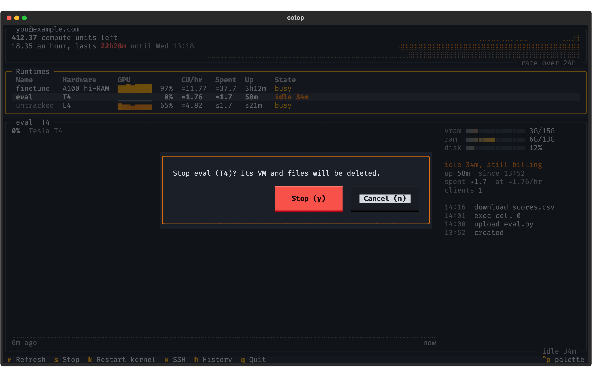

# cotop

`top` for Google Colab: compute units, runtimes and what they cost, live in your terminal.


- **Your account:** compute units left, the hourly rate, when you run out, and the rate over the last day. Compute units left turn red when they run out within a day.
- **Runtimes:** every VM on your account, most expensive first, including ones opened in a browser, with a live GPU sparkline, rate, spend, uptime and state. A runtime idle while it bills, out of RAM or disk, or unreachable says so in its row.
- **The selected runtime:** a braille graph of GPU utilization, read every two seconds, with VRAM, RAM and disk meters, what it has cost and its recent activity. On a runtime without a GPU, the graph shows RAM.
- **History:** press `h` for past sessions, how long each ran and roughly what it cost.
- **Actions:** stop a runtime, restart its kernel, or open a shell on it.

cotop works on top of the official [Colab CLI](https://pypi.org/project/google-colab-cli/). It uses the CLI's sign-in, session names and history, so runtimes you start with `colab new` show up by name.

## Install

```sh
uv tool install cotop
cotop
cotop --demo   # a made-up account with twelve runtimes; no sign-in
```

cotop needs Python 3.12 or later. It is tested on macOS and should work on Linux. If you have not signed in to the Colab CLI yet, cotop runs the same Google sign-in on first launch. On macOS, Keychain may ask once whether cotop's Python can read the Colab CLI's token.

## Keys

| Key | Action |
|---|---|
| `↑` `↓` or `k` `j` | Select a runtime |
| `h` | Past sessions and the hardware your account can use |
| `r` | Refresh now (cotop also refreshes every 15 seconds) |
| `s` | Stop the selected runtime |
| `R` | Restart its kernel |
| `x` | Open a shell on it with `colab ssh` |
| `?` | Show every key |
| `q` | Quit |



Stop and restart ask first, and Cancel has focus. `colab ssh` looks for `~/.ssh/id_ed25519.pub` or `~/.ssh/id_ecdsa.pub`. For another key, start cotop with `cotop -i ~/.ssh/KEY.pub`. Restart and ssh work only on runtimes started with the Colab CLI. Stop works on any runtime.

## Which numbers are estimates

Colab reports one hourly rate for the whole account, not one per runtime. cotop shows a per-runtime rate as follows:

- With one runtime, the rate is exact.
- With several runtimes on the same hardware, cotop splits the total evenly.
- Otherwise cotop uses a rate it learned earlier, when only that hardware was running. These rates are stored in `~/.cache/cotop/rates.json`.
- With no learned rate, the column shows `?`.

Estimates start with `≈`, and upper bounds start with `≤`. Colab boots VMs before it assigns them, so uptime and spend count from the assignment time in the CLI's history. A runtime opened in a browser has no assignment time, so cotop counts from VM boot and shows an upper bound.

[docs/data-sources.md](docs/data-sources.md) lists each request cotop makes and what it reads.

## What cotop can touch

cotop signs in with the Colab CLI's own credentials, so it can do anything `colab` can, with the access you granted when you signed in. It adds no credentials of its own.

### cotop's own code

This table is complete for cotop's code:

| | What | When |
|---|---|---|
| Sends | GET `colab.research.google.com` `/tun/m/ccu-info` and `/tun/m/assignments` | Every 15 s. `/assignments` also before each `colab` command |
| Sends | GET Google's userinfo endpoint, for your email address | Once, at start |
| Sends | GET each runtime's proxy, at the URL Colab returns for it, with that runtime's proxy token: `/api/status` and `/api/kernels` every 15 s, `/api/colab/resources` every 2 s | While the runtime is listed |
| Reads | `~/.config/colab-cli/history/*.jsonl`, and the CLI's session list through the library (below) | Every 15 s. The session list also before each `colab` command |
| Reads | `~/.cache/cotop/rates.json` and `~/.cache/cotop/usage.jsonl` | At start |
| Writes | `~/.cache/cotop/rates.json` and `~/.cache/cotop/usage.jsonl`, each through a temporary file in that directory | When a rate or the balance changes |
| Runs | The `colab` installed beside cotop's Python, with exactly the arguments below | After you press `s` or `R` and confirm, or when you press `x` |

- From the CLI's history, cotop shows only event types, times and file names. It never shows code, outputs, anything typed at a prompt, or a token.
- In its own process, cotop keeps the CLI library's loggers at WARNING and never turns on the CLI's log file.
- Before it runs a `colab` command on a name, cotop checks that the name still points at the same runtime.
- `cotop --demo` does none of the above. It sends no requests and keeps its cache in a temporary directory.

### Calls into the Colab CLI

cotop hands these to `google-colab-cli`:

- `get_credentials()`, once at start. Its signed-in session sends the requests to `colab.research.google.com` and the userinfo endpoint above, and refreshes its access token when that expires.
- `StateStore(...).list()`, to read the CLI's sessions, once `~/.config/colab-cli/sessions.json` exists.
- `Client(Prod(), session).unassign(endpoint)`, to stop a runtime the CLI didn't start.
- `colab stop -s NAME`, `colab restart-kernel -s NAME` and `colab ssh -s NAME [-i KEY]`.

cotop passes them no options of its own, so they behave as they do inside `colab`. What they read, write and send is the CLI's behavior, and it is fixed in the CLI.

### What the CLI does (0.8.0; not a complete list)

These examples are taken from [google-colab-cli 0.8.0](https://pypi.org/project/google-colab-cli/0.8.0/):

- `get_credentials()` reads and writes the OS keyring. It moves an old plaintext `~/.config/colab-cli/token.json` into the keyring, and it reads `~/.colab-cli-oauth-config.json` if that file exists.
- `colab` commands:
  - log to `~/.config/colab-cli/colab.log`, with secrets redacted;
  - update files under `~/.config/colab-cli/`;
  - check `pypi.org` for an update at most once a day.
- `colab ssh` reads your SSH public key.

## Not affiliated with Google

cotop is an independent project. It relies on internal parts of `google-colab-cli` and on Colab endpoints that are not public APIs. Either can change without notice. cotop pins the Colab CLI's minor version for that reason.

## Development

```sh
uv sync
uv run pytest
uv run python scripts/screenshots.py OUT_DIR   # README screenshots, rendered from the demo account
```

To release, set `version` in `pyproject.toml`, then push a matching tag such as `v0.1.0`. The [publish workflow](.github/workflows/publish.yml) builds the package and uploads it to PyPI with trusted publishing.

## License

[Apache 2.0](LICENSE)
