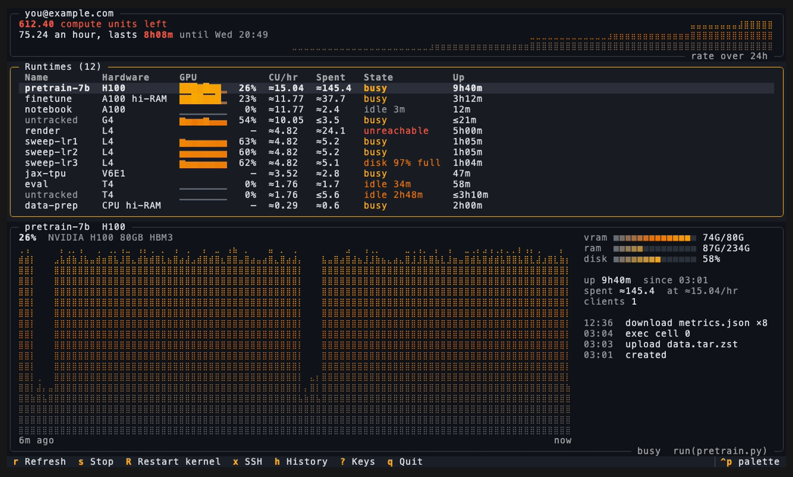

# cotop

`top` for Google Colab. Watch your compute units, burn rate, and live runtimes, with 2-second GPU graphs and idle-billing warnings.



## Install

Requires Python 3.12 or later on macOS or Linux. Tested on macOS.

```sh
uv tool install cotop
cotop
cotop --demo              # 12 made-up runtimes, no sign-in
cotop -i ~/.ssh/KEY.pub   # custom public key for colab ssh on x
```

`cotop` shares sign-in, session names, and history with the official [Colab CLI](https://pypi.org/project/google-colab-cli/), and runs its Google sign-in on first launch if needed. Runtimes without a local CLI session, such as browser notebooks, appear as `untracked` and still support `s` to stop. `R` to restart a kernel and `x` for SSH require a CLI session name. Press `?` for the key list.

Per-runtime figures mark estimates with `≈` and VM-boot upper bounds with `≤`. [docs/data-sources.md](https://github.com/benngarcia/cotop/blob/main/docs/data-sources.md) explains the calculations and lists the requests `cotop` makes.

## Safety

- `cotop` signs in with your `google-colab-cli` credentials and adds no credentials of its own.
- Proxy reads pass `no_track_activity=1` so Jupyter's `last_activity` does not advance. See the [idle-reclaim test](https://github.com/benngarcia/cotop/blob/main/docs/data-sources.md#watching-did-not-keep-an-idle-runtime-alive) and its limits.
- Stop and kernel-restart prompts focus **Cancel**, and named actions re-check that the session name still points at the selected VM.
- `cotop` is an independent project, not affiliated with Google, and relies on internal `google-colab-cli` `~=0.8.0` APIs and undocumented Colab endpoints. [SECURITY.md](https://github.com/benngarcia/cotop/blob/main/SECURITY.md) lists the test-backed guarantees and what `cotop` touches.

[MIT](https://github.com/benngarcia/cotop/blob/main/LICENSE)
